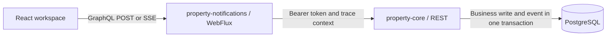

# Portfolio GraphQL and organization notifications

The project brief assigns GraphQL to the portfolio dashboard and WebFlux to maintenance
and payment notifications. The React dashboard reads portfolio counts through GraphQL and
can fall back to the existing REST summary. The header bell opens **Notifications**, with an unread badge and recent activity. The published [GraphQL contract](../../api-contracts/graphql/notifications.graphqls)
mirrors the [runtime schema](src/main/resources/graphql/notifications.graphqls), which Spring
loads at startup. Update the runtime schema first and copy it to the contract path
when changing the API. The QA runner checks that the two files match.

## Architecture decision

Keep the business transactions and notification event log in `property-core`.
A PostgreSQL trigger appends the event in the same transaction as a maintenance
request creation, a maintenance status change, or a recorded rent payment.
Rolled-back changes leave no event. A per-organization counter serializes event
number allocation until commit so a client can resume from its last received cursor.



The notification service has no database credentials. It validates the core JWT and
forwards it to the core service. Core applies current organization and role permissions
on each feed read, including during a stream. Maintenance events require maintenance
access and payment events require billing access. Events contain resource identifiers
and statuses, with no payer details, amounts, or maintenance notes.

The subscription reads bounded batches using WebClient and polls the durable feed every
four seconds. Connections rotate after 55 seconds. Resume with the last cursor received.
The browser loads recent history first, starts from its latest cursor, and reconnects
automatically. The current design performs an authorization check and indexed read per
active subscriber on each poll. Maintenance and billing notifications have per-user
read receipts. The support feed includes replies across organizations the user owns,
including those under review, and uses the same read status as the support conversation.
The header checks for support replies every five seconds while the tab is visible.

## Start the services

For the Compose stack, follow [the deployment guide](../../deploy/README.md).
Nginx serves the browser endpoint at `/api/graphql` and disables buffering there.
In local development, start core on port 8081 with its existing configuration, then
run `./mvnw spring-boot:run` from this directory with the same `JWT_SECRET`.
Set `CORE_URL` if core listens on another address. The notification service listens
on port 8082. Vite forwards `/api/graphql` on the frontend origin.

## Example operations

Send a JSON request with a valid `Authorization: Bearer …` header to the browser origin.
Pass an organization UUID as the `org` variable.

```graphql
query OrganizationOverview($org: ID!) {
  portfolioDashboard(organizationId: $org) {
    totalProperties
    totalUnits
    occupiedUnits
  }
  notifications(organizationId: $org, limit: 10) {
    cursor
    kind
    resourceId
    maintenanceStatus
    occurredAt
  }
}
```

For a subscription, use HTTP POST with `Accept: text/event-stream` and the same bearer
header. Set `after` to the last cursor received, or omit it to listen for new events.

```graphql
subscription WatchOrganization($org: ID!, $after: String) {
  notificationEvents(organizationId: $org, after: $after) {
    cursor
    kind
    resourceId
    maintenanceStatus
    occurredAt
  }
}
```

## Verification and tracing

Run `QA_SPEC=notifications.spec.ts npm --prefix frontend run qa:e2e` from the repository
root. The runner starts both services with a disposable PostgreSQL database. It checks
the GraphQL dashboard, streamed maintenance and payment events, rejected duplicate payment
effects, and organization and role isolation.

Health is available at `/actuator/health` on the notification service. The metrics endpoint
is restricted to loopback connections and is available from inside its container.
To collect a cross-service trace in Compose, start with
`ZIPKIN_ENABLED=true TRACE_SAMPLING_PROBABILITY=1 docker compose --profile observability up -d --build`
from the deployment directory. Open the dashboard or notification feed, then view the
`property-notifications` trace in Zipkin at `http://localhost:9411`. It includes the
outbound WebClient span and the corresponding `property-core` HTTP span.
